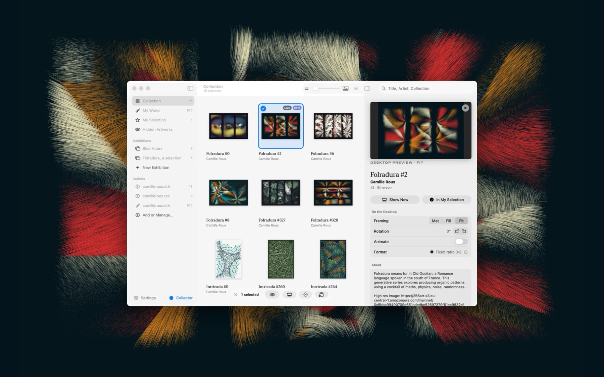

# Cadrelia (test version)

> **This is an early test version, shared to collect feedback.** Things may change, break or disappear
> between versions. Please don't rely on it yet, and tell me what you find.

Cadrelia hangs the art in your crypto wallets on your Mac's desktop: images, videos, GIFs and generative
pieces. The ones that move can play live, the way their artist intended, and switch to a still image when the
battery needs it. It reads your wallets without
connecting to them: no signature and no private key.

*The Library over the desktop, with Folradura #2 selected and shown whole (Fit) as the wallpaper.*

It works with Ethereum (with Base, Optimism, Arbitrum and Polygon), Tezos and Bitcoin Ordinals. It needs
**macOS 14 Sonoma or later**.

## Download

**[Download Cadrelia (latest test version)](https://github.com/camilleroux/cadrelia/releases/latest/download/Cadrelia.zip)**

1. Open the zip and move **Cadrelia** to your Applications folder.
2. Open it. Since this test version isn't signed by Apple yet, macOS blocks it the first time.
3. Go to **System Settings › Privacy & Security**, scroll down to the message about Cadrelia, and click
   **Open Anyway**. You only do this once.
4. Add a wallet address or name (`name.eth`, `name.tez`, `0x…`, `tz…`, `bc1…`), or try the example collection.

Updates arrive in the app itself: *Check for Updates…* in the menu bar. Every version, with what changed: [Releases](https://github.com/camilleroux/cadrelia/releases).

## Feedback

Everything helps: bugs, confusing bits, ideas, artworks that don't display well.

- In the app: **Send Feedback…** in the menu bar. It opens an issue here, with technical details (versions,
  counts, settings, recent errors) already filled in. **They contain no wallet address.**
- Or [open an issue](https://github.com/camilleroux/cadrelia/issues/new/choose) directly.

Issues are public: don't paste a wallet address you'd rather keep private.

## Privacy

Cadrelia only reads public blockchain data, through public indexers (objkt, TzKT, OpenSea, Blockscout, an
Ordinals server). Your library stays on your Mac. No account, no analytics, no tracking.

## Collector features

Collectors of my major series (ARTERIA, The Source, Résilience, Folradura, Intricada, The Destination) get a
few extras: exhibitions, frames and label styles. The Collector page in the app explains how they work.

---

Made by [Camille Roux](https://art.camilleroux.com). The source code isn't public. All rights reserved.
